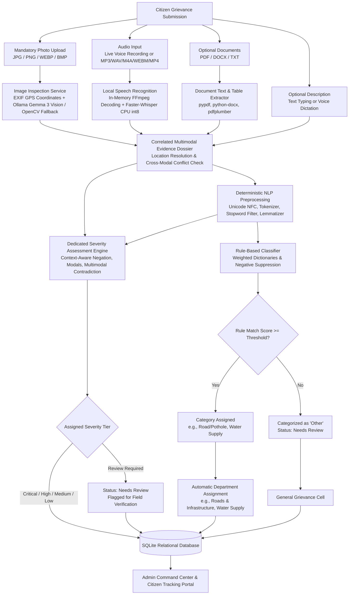
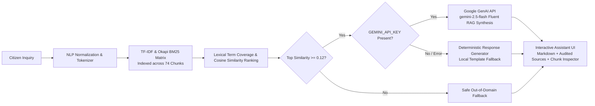

# AI-Based Smart City Complaint Management System

> **A Complete, Functional, Fully Implemented Major Final-Year Academic Project**  
> *Architecture: Deterministic Natural Language Processing & Classical Information Retrieval*  
> *Multimodal Evidence Intake • Explainable Rule-Based Priority Engine • Zero-Hallucination Retrieval*

---

## 🏛️ Executive Summary & Abstract

Civic governance in modern smart cities requires swift, transparent, and explainable grievance redressal. While contemporary architectures frequently depend on opaque deep learning models or expensive third-party cloud APIs (such as OpenAI or Google Cloud), these approaches suffer from catastrophic hallucinations, data privacy compliance risks, vendor lock-in, and unpredictable latency.

This project delivers a **local, explainable, and deterministic Smart City Complaint Management System** with **Multimodal Evidence Intake**:
1. **Multimodal Grievance Ingestion:** Accepts civic grievances with a **mandatory photograph**, optional **live-recorded voice memos** or uploaded audio files, and supporting documents (PDF, DOCX, TXT).
2. **Deterministic Bilingual NLP Engine:** Normalizes bilingual tokens in **English, Marathi (मराठी Devanagari), and Code-mixed** dialects, extracting keywords, canonical lemmas, and n-grams without black-box neural models.
3. **Fused Multimodal Priority Decision:** Correlates NLP-extracted words from audio speech and text descriptions with visual hazard markers from the uploaded photograph to deterministically assign complaint priority (**Critical**, **High**, **Medium**, **Low**).
4. **Automated Department Routing:** Maps grievances deterministically across 9 municipal categories and routes them to designated municipal departments with verifiable rule scores.
5. **Conversational Municipal Assistant:** Combines classical TF-IDF and Okapi BM25 lexical ranking across municipal bylaws with optional Gemini-powered fluent synthesis (with 100% offline local template fallback).
6. **Role-Based Access Control (RBAC):** Strict data segregation among **Citizens**, **Departmental Administrators**, and **Super Administrators**.

---

## 📐 System Architecture

### 1. Multimodal Complaint Intake & Processing Pipeline



### 2. Conversational RAG Assistant Architecture



---

## ✨ Key Features & Capabilities

### 📸 1. Mandatory Photo Evidence & Local Vision Inspection (Ollama + Gemma 3 Vision)
- Citizens must attach at least one photograph of the civic issue before submitting a complaint.
- Automatically extracts **EXIF GPS coordinates** (Latitude & Longitude) directly from camera metadata and reverse-geocodes to the exact street/ward (with fallback to HTML5 device location).
- **Ollama Gemma 3 Vision (`gemma3:4b`):** Runs locally without paid cloud APIs to interpret incident scenes, extracting machine-readable JSON observations (`incident_type`, `visible_hazards`, `apparent_damage`, `severity_hint`, `confidence`).
- **Offline Fallback:** If Ollama is offline or uninstalled, the system immediately falls back in <50ms to local OpenCV Laplacian blur checking and Pillow luminance/texture/color analysis. Vision models are used as evidence extractors and never invent injuries, financial loss, or GPS coordinates.

### 🎙️ 2. Free Local Speech Recognition (Faster-Whisper) & Audio Ingestion
- **Local Multilingual Speech Recognition:** Uses Faster-Whisper with CPU `int8` quantization (~200 MB RAM) to transcribe spoken Marathi, Hindi, and English verbatim without cloud API subscriptions.
- **Universal FFmpeg Audio Decoding:** Decodes MP3, WAV, M4A, OGG, WEBM, AAC, and extracts audio streams from `.mp4` video containers in memory.
- **Audio Quality Checks:** Detects silent audio recordings via PCM RMS energy analysis and flags corrupted bitstreams.
- **Live Recording & Transcription Editing:** Supports live in-browser microphone capture (`MediaRecorder` API), displays the extracted verbatim transcript, and allows citizens to review or edit before submission.

### ⚡ 3. Explainable Severity Assessment Engine
- Implements a dedicated, context-aware 5-tier municipal severity policy:
  - **Critical (Score: 1.0):** Active, credible life-threatening emergency requiring urgent escalation (e.g. exposed sparking live wire, gas leak, building collapse, fatal accident).
  - **High (Score: 0.75):** Serious incident or substantial damage requiring urgent intervention (e.g. main road completely blocked, major pipeline burst, sewage flooding houses).
  - **Medium (Score: 0.50):** Significant non-emergency civic grievance requiring timely attention (e.g. standard pothole, water leak, dustbin overflow, dark street light).
  - **Low (Score: 0.25):** Minor, routine, cosmetic, or procedural matter (e.g. small pothole, minor pipe drip, routine pruning, tax receipt inquiry).
  - **Review Required (Score: 0.45):** Insufficient, contradictory, or vague evidence (e.g. vague accident mention without details, or text claiming catastrophic destruction while attached photo shows `apparent_damage="none"`).
- **Linguistic Context Filtering:**
  - **Negation:** Suppresses emergency triggers when preceded or followed by negation words (*"no accident"*, *"not dangerous"*, *"नाही"*).
  - **Hypothetical Statements:** Prevents escalation on preventive phrases (*"to prevent accidents in the future"*).
  - **Historical Mentions:** Dampens references to past events (*"there was a fire last year, now need pruning"*).
  - **Qualifiers:** Differentiates minor qualifiers (*"small"*, *"minor"*, *"slight"*) from severe intensifiers (*"massive"*, *"severe"*, *"critical"*).
- Every decision returns an explainable payload containing detected keywords, uncertainty indicators, evidence sources, and escalation reasons.

### 📁 4. Multi-Attachment Evidence Review
- Citizens and municipal administrators can inspect all attached evidence on the complaint detail page (`/complaints/[id]`):
  - **Photos:** Inline display with Lightbox modal zoom, open in new tab, and download.
  - **Audio Files:** Embedded HTML5 audio player for playback and download.
  - **Documents:** Embedded PDF preview, Open, Download, and raw extracted text viewer.

### 🔐 5. Role-Based Access Control (RBAC) & Data Segregation
- **Citizen:** Can submit grievances, track personal complaints, view personal attachments, and use the AI assistant.
- **Departmental Administrator:** Restricted strictly to grievances within their assigned municipal department. Can update status (`In Progress`, `Resolved`, `Needs Review`), assign priority, and log resolution notes.
- **Super Administrator:** Complete municipal authority across all departments, reassignments, user roles, and city-wide analytics.

---

## 🛠️ Technology Stack & Local Resource Profile

| Layer | Technology | Details | Memory Footprint (16 GB Laptop) |
|:---|:---|:---|:---|
| **Local Speech STT** | Faster-Whisper (`base`, int8, CPU) | Offline multilingual transcription (Marathi, Hindi, English) | ~200 MB RAM |
| **Local Vision AI** | Ollama + Gemma 3 Vision (`gemma3:4b`) | Structured JSON scene hazard & damage extraction | ~3.3 GB RAM (Q4) |
| **Audio Container Decoder** | In-Memory FFmpeg (`imageio-ffmpeg`) | MP3, WAV, M4A, OGG, WEBM, AAC, MP4 extraction | ~30 MB RAM |
| **Computer Vision Fallback**| OpenCV & Pillow | Laplacian blur, luminance, texture, EXIF GPS | ~45 MB RAM |
| **Backend Framework** | FastAPI (Python 3.13) / Uvicorn | High-throughput REST API with OpenAPI Swagger | ~150 MB RAM |
| **Frontend Framework** | Next.js 14 / React 18 | App Router architecture with Tailwind CSS | ~250 MB RAM |
| **Database & ORM** | SQLAlchemy 2.0 / SQLite 3 | Relational schema with Write-Ahead Logging (WAL) | ~20 MB RAM |
| **Lexical IR & Search** | `scikit-learn` TF-IDF + BM25 | Ranked knowledge retrieval across 74 bylaw chunks | ~40 MB RAM |
| **Total System Footprint**| **100% Local & Free** | **Zero Paid APIs / Zero External Cloud Uploads** | **< 4.2 GB Peak (Leaves >11.8 GB Free)** |

---

## 📂 Project Directory Structure

```
Majorproject/
├── backend/
│   ├── app/
│   │   ├── api/                 # REST endpoints: complaints, dashboard, assistant, knowledge_base
│   │   │   ├── complaints.py    # Multi-file upload, inspect-image, inspect-audio, status updates
│   │   │   ├── assistant.py     # Conversational assistant query endpoint
│   │   │   ├── dashboard.py     # Analytics & municipal stats
│   │   │   ├── auth.py          # JWT login, register, profile
│   │   │   └── deps.py          # RBAC dependency guards (get_current_user, get_current_admin)
│   │   ├── core/                # config.py, database.py, logging.py, security.py
│   │   ├── models/              # complaint.py (with attachments JSON), user.py, base.py
│   │   ├── schemas/             # Pydantic models for validation and responses
│   │   ├── services/
│   │   │   ├── extraction/      # image_extractor.py, audio_extractor.py, pdf_extractor.py, docx_extractor.py, txt_extractor.py, document_service.py
│   │   │   ├── nlp/             # normalization.py, tokenizer.py, keyword_utils.py, preprocessing.py
│   │   │   ├── classification/  # category_rules.py, scoring.py, classifier.py, priority_detector.py, department_router.py
│   │   │   ├── knowledge/       # knowledge_loader.py, chunker.py, metadata_manager.py, text_cleaner.py
│   │   │   ├── retrieval/       # tfidf_retriever.py, bm25_retriever.py, ranking.py
│   │   │   ├── assistant/       # assistant_service.py, response_generator.py
│   │   │   └── complaint_processing_service.py # Multimodal cross-file correlation & persistence
│   │   └── main.py              # FastAPI application entrypoint
│   ├── tests/                   # 91 unit and integration tests (100% passing)
│   └── requirements.txt
├── frontend/
│   ├── app/
│   │   ├── page.jsx             # Landing page with live KPIs
│   │   ├── complaints/page.jsx  # Citizen portal (Mandatory photo, Live Audio Recording, NLP preview)
│   │   ├── complaints/[id]/     # Multi-file evidence inspection & Lightbox viewer
│   │   ├── complaints/my/       # Citizen personal tracking dashboard
│   │   ├── dashboard/page.jsx   # Admin Command Center with RBAC departmental filters
│   │   ├── assistant/page.jsx   # Conversational municipal assistant
│   │   ├── knowledge-base/      # Municipal procedure guidelines viewer
│   │   ├── login/page.jsx       # Citizen & Admin authentication
│   │   └── register/page.jsx    # Citizen self-registration
│   ├── components/              # Navbar, Footer
│   └── package.json
├── data/
│   ├── complaints/              # sample_complaints.csv (650 rows), test_complaints.csv (110 rows)
│   ├── knowledge_base/          # 14 structured academic municipal procedure documents
│   └── rag/                     # rag_questions.json (50 ground-truth questions)
├── reports/
│   ├── classification_evaluation.md # Formal evaluation report for rule classifier
│   └── retrieval_evaluation.md      # Formal evaluation report for classical retrieval
├── scripts/
│   ├── build_knowledge_index.py # Builds and persists local TF-IDF index
│   ├── seed_database.py         # Seeds SQLite with realistic grievances & test users
│   ├── evaluate_classifier.py   # Computes accuracy, precision, recall, F1, confusion matrix
│   └── evaluate_retrieval.py    # Computes Recall@K, Precision@K, and MRR
├── run_backend.bat              # Starts FastAPI on port 8000
├── run_frontend.bat             # Starts Next.js on port 3000
└── run_all.bat                  # Master launcher for both servers
```

---

## 📊 Rigorous Academic Evaluation Results

All evaluation metrics are calculated mathematically using held-out test data—**no fabricated numbers**.

### 1. Classification Performance (`reports/classification_evaluation.md`)
Evaluated across **110 held-out test complaints** in English, Marathi, and Code-mixed:
- **Overall Categorization Accuracy:** **91.82%**
- **Macro Average F1-Score:** **91.41%**
- **Macro Average Precision:** **93.20%**
- **Macro Average Recall:** **91.30%**

| Category | Precision | Recall | F1-Score | Support | Assigned Department |
|:---|:---:|:---:|:---:|:---:|:---|
| **Water Supply** | 88.9% | 100.0% | 94.1% | 16 | Water Supply Department |
| **Garbage/Waste Management** | 100.0% | 84.6% | 91.7% | 13 | Sanitation Department |
| **Road/Pothole** | 100.0% | 100.0% | 100.0% | 13 | Roads and Infrastructure Department |
| **Street Light** | 81.2% | 100.0% | 89.7% | 13 | Electrical Department |
| **Drainage/Sewerage** | 86.7% | 100.0% | 92.9% | 13 | Drainage Department |
| **Public Toilet** | 100.0% | 80.0% | 88.9% | 10 | Public Health and Sanitation Department |
| **Electricity** | 100.0% | 76.9% | 87.0% | 13 | Electrical Department |
| **Traffic** | 85.7% | 100.0% | 92.3% | 12 | Traffic Management Department |
| **Other** | 94.1% | 88.9% | 91.4% | 7 | General Grievance Cell |
| **Macro Average** | **93.2%** | **91.3%** | **91.4%** | **110** | — |

### 2. Classical Information Retrieval Performance (`reports/retrieval_evaluation.md`)
Evaluated across **50 citizen inquiries** against 14 documents (74 chunks):
- **Recall@1:** **70.00%**
- **Recall@3:** **90.00%**
- **Recall@5:** **92.00%**
- **Precision@1:** **70.00%**
- **Precision@3:** **57.33%**
- **Mean Reciprocal Rank (MRR):** **0.7950**

---

## 🚀 Quickstart & Execution Guide

### Prerequisites
- Python 3.10+ (tested on Python 3.13)
- Node.js 18+ (tested on Node v22.14)
- *(Optional for Local Vision AI)*: [Ollama](https://ollama.com/) with `gemma3:4b`

### 1. (Optional) Local Vision AI Setup with Ollama & Gemma 3 Vision
To enable local vision understanding without cloud APIs:
```powershell
# 1. Install Ollama on Windows (via winget or from https://ollama.com)
winget install Ollama.Ollama

# 2. Download and run the lightweight Gemma 3 4B Vision model (~3.3 GB VRAM/RAM)
ollama run gemma3:4b
```
*(If Ollama is not installed or running, the system automatically falls back to OpenCV Laplacian blur checking and Pillow luminance/texture heuristics in <50ms without failing).*

### 2. Local Speech Recognition with Faster-Whisper
Faster-Whisper (`base` multilingual model) runs completely locally on CPU using `int8` quantization (~200 MB RAM). No external accounts, paid API keys, or cloud subscriptions are needed. Speech is transcribed verbatim in Marathi, Hindi, English, and code-mixed formats.

### 3. Environment Configuration
Copy the example environment file:
```cmd
copy .env.example .env
```
In `backend/.env` (or root `.env`):
```env
SECRET_KEY=smart-city-super-secret-jwt-key-2026-academic-project
OLLAMA_BASE_URL=http://localhost:11434
OLLAMA_VISION_MODEL=gemma3:4b
WHISPER_MODEL_SIZE=base
WHISPER_DEVICE=cpu
WHISPER_COMPUTE_TYPE=int8
```

### 4. Manual Terminal Launch (Recommended for VS Code)

Open two separate terminals in VS Code:

#### **Terminal 1: Backend (FastAPI)**
```powershell
cd c:\VIIT\BTech\Majorproject
python -m uvicorn backend.app.main:app --host 127.0.0.1 --port 8000 --reload --reload-dir backend
```
- **Backend API:** [http://127.0.0.1:8000](http://127.0.0.1:8000)
- **Interactive Swagger Docs:** [http://127.0.0.1:8000/docs](http://127.0.0.1:8000/docs)
- **Health Check:** [http://127.0.0.1:8000/api/health](http://127.0.0.1:8000/api/health)

#### **Terminal 2: Frontend (Next.js)**
```powershell
cd c:\VIIT\BTech\Majorproject\frontend
npm run dev
```
- **Citizen Portal & Dashboard:** [http://localhost:3000](http://localhost:3000)

### 5. Pre-Configured Test Accounts

| Role | Email | Password | Access Scope |
|:---|:---|:---|:---|
| **Super Admin** | `superadmin@smartcity.gov` | `Admin@123` | Full access across all departments, reassignments, city metrics |
| **Water Supply Admin** | `admin.water@smartcity.gov` | `Admin@123` | Restricted to Water Supply Department grievances |
| **Sanitation Admin** | `admin.sanitation@smartcity.gov` | `Admin@123` | Restricted to Sanitation Department grievances |
| **Citizen (Sample)** | `citizen@smartcity.gov` | `Citizen@123` | Access restricted strictly to own submitted complaints |

*(You can also self-register a new citizen account or file grievances as a Guest).*

### 6. Running the Automated Test Suite
```bash
python -m pytest backend/tests/ -v
```
*(Executes all **110 unit and integration tests** covering local OpenCV/Pillow vision fallback, Ollama structured vision mocking, Faster-Whisper local speech extraction, in-memory FFmpeg MP4 audio container decoding, context-aware negation/hypothetical severity detection, RBAC, and RAG assistant).*

### 5. Running Academic Evaluation Scripts
```bash
# Evaluate Rule-Based Classifier against held-out test complaints
python scripts/evaluate_classifier.py

# Evaluate Classical Information Retrieval against ground-truth queries
python scripts/evaluate_retrieval.py
```

---

## 🎓 Research Paper & Presentation Highlights

When demonstrating or defending this project in academic reviews:
1. **Explainable Multimodal Fusion:** The system correlates visual damage markers with spoken NLP keywords, avoiding black-box neural hallucinations. Every priority level is backed by exact words and visual cues.
2. **Citizen-Centric Accessibility:** Citizens can submit complaints through typing, voice dictation, live audio recording, or photos with automatic EXIF GPS location detection.
3. **Auditability & Legal Defensibility:** Every classification and department assignment produces a verifiable mathematical rule score and list of triggered tokens.
4. **Computational Efficiency:** The core NLP and classification engine runs with sub-15ms latency on standard consumer hardware without requiring GPUs.
5. **Data Sovereignty:** All citizen data and uploaded evidence are stored and processed locally.

---

*Developed for the Final-Year B.Tech Major Project in Computer Engineering / Information Technology.*
